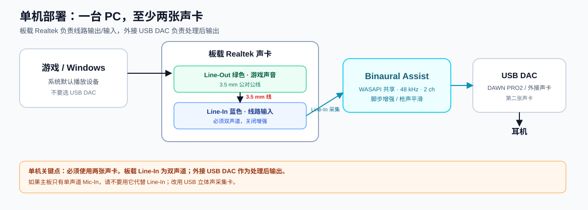
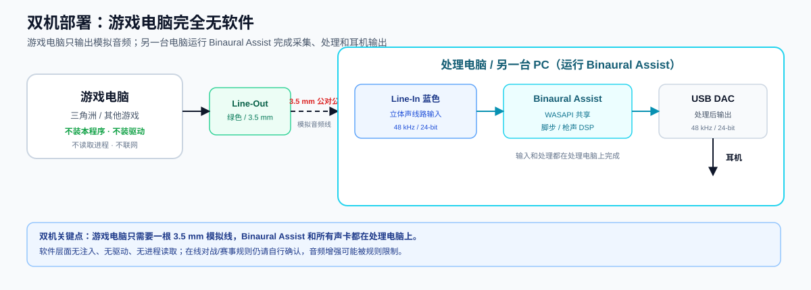

# Binaural Assist

**物理回环 · 双声道 HRTF 音频辅助**  
脚步方向/微声增强、枪声平滑、游戏进程自动启停、Web 调音台。

[下载 Release](https://github.com/Snowail/BinauralAssist/releases/latest) · [源码](https://github.com/Snowail/BinauralAssist)

---

## 这个程序是什么

Binaural Assist 处理的是**真实声卡之间的模拟音频**，不是虚拟声卡、不注入游戏进程、不读取游戏内存、不修改游戏文件。

```
游戏/系统声音 → 线路输出 → 3.5 mm 线 → 线路输入
              → Binaural Assist DSP → USB DAC → 耳机
```

适用于游戏输出 **HRTF 双声道** 的情况，保留原有的 ITD/ILD/耳廓频谱线索，只做立体声联动的动态增强。

### 主要功能

- 脚步：向上压缩、低频/中频细节增强、侧信号（L−R）增强；
- 枪声：动态高频衰减 + 立体声联动 lookahead 限幅；
- 只支持 **WASAPI 共享模式**，不再提供不可用的独占模式；
- Web 调音台：实时电平、脚步/枪声活动、L/R 相关、延迟、xrun；
- 配置预设：当前配置自动保存、自定义预设、导入/导出、上次配置恢复；
- 游戏识别：白名单 exe，检测到游戏启动自动开始音频，全部退出后自动停止；
- 训练数据：截取、试听、人工标注、2ch 事件模型训练/热加载；
- 局域网访问：手机在同一局域网可打开控制台（可选密码）；
- 托盘运行：双击打开网页、右键设置/切换配置/关闭并退出。

---

## 直接运行（Windows 便携版）

1. 打开 [Releases](https://github.com/Snowail/BinauralAssist/releases/latest)，下载 **`BinauralAssist-portable.zip`**；
2. 解压到任意目录（路径可以有空格/中文）；
3. 双击 **`Binaural Assist.exe`**。

启动后：

- 程序没有主窗口，只在右下角任务栏托盘运行；
- **不会自动打开浏览器**；
- 需要 **双击托盘图标**，才会用默认浏览器打开控制台：
  - 本机：`http://127.0.0.1:8765`
  - 手机：`http://<处理电脑局域网 IP>:8765`
- Windows 11 可能把新程序的托盘图标放进任务栏的 **`^` 溢出区**。第一次请点 `^`，把 **Binaural Assist** 拖到任务栏固定；也可以在“设置 → 个性化 → 任务栏 → 其他系统托盘图标”中打开。

### 第一次使用

1. 双击托盘图标打开网页；
2. 在“调音台”选择：
   - 输入：**Realtek Line-In（蓝色）**；
   - 输出：**USB DAC / 耳机**；
3. 点 **启动音频**，确认 L/R 电平、L/R 相关、延迟正常；
4. 正常听到处理后声音后，程序会记住这次的输入/输出设备。

**第一次配置好设备后，后续才能自动开启。** 之后：
- 托盘菜单勾选“游戏启动自动开启音频处理”（默认开启）时，检测到白名单游戏会自动开始；
- 游戏全部退出后自动停止；
- 取消勾选则完全手动，不再识别游戏进程；
- 双击托盘只打开网页，不会强制开始音频。

### 退出

- 网页右上角 **⏻ 退出**：停止音频、关闭 WebUI 和托盘；
- 托盘右键 → **关闭服务并退出**：效果相同。

---

## 物理接线

### 单机部署：一台 PC，至少两张声卡



单机需要：

1. **板载声卡**：使用主板的 **Line-In（蓝色）**，必须是**双声道**；
2. **外接声卡 / USB DAC**：负责处理后输出到耳机。

典型接线：

```text
游戏/Windows
  │ 系统默认播放设备 = 板载 Realtek Line-Out（绿色）
  ▼
3.5 mm 公对公线
  ▼
板载 Realtek Line-In（蓝色）
  │
  ▼
Binaural Assist
  │
  ▼
USB DAC（如 DAWN PRO2）→ 耳机
```

注意：

- Windows 的**默认播放设备要选板载 Realtek Line-Out**，不是 USB DAC；否则游戏声音直接去耳机，不会进入线路输入；
- Binaural Assist 的输入选 **Line-In**，输出选 **USB DAC**；
- 大多数现代主板的板载 Line-In 已支持双声道；如果只有单声道 Mic-In，请改用 USB 立体声采集卡；
- 单机不要只靠一张声卡同时做“游戏输出 + 处理后输出”，否则无法构成独立回环。

### 双机部署：游戏电脑完全无软件



```text
游戏电脑 ── 3.5 mm 模拟线 ── 处理电脑（Line-In）
                                  │
                                  ▼
                           Binaural Assist
                                  │
                                  ▼
                            USB DAC → 耳机
```

- 游戏电脑只需要一根 **3.5 mm 公对公线**，从游戏电脑的 Line-Out 接到处理电脑的 Line-In；
- 游戏电脑**不安装本程序、不装虚拟声卡/驱动、不读取游戏进程、不联网**；
- 处理电脑运行 Binaural Assist，并接 USB DAC/耳机；
- 两台电脑之间是模拟音频线，不经过网络，不增加网络延迟；
- 软件层面“无痕”，但在线对战/赛事规则仍请自行确认：音频增强可能被规则限制。

---

## 延迟说明

**本方案不是零延迟，可能有可察觉的音频延迟。**

本机实测（Realtek Line-In → DAWN PRO2，WASAPI 共享模式）：

| block | 输入缓冲 | 输出缓冲 | 合计（含 DSP） |
| ---: | ---: | ---: | ---: |
| 64 | 22.0 ms | 23.3 ms | **46.9 ms** |
| 128 | 22.0 ms | 24.7 ms | **49.6 ms** |
| 256 | 22.0 ms | 27.3 ms | **54.9 ms** |

还要加上：

- 声卡 ADC/DAC 模拟延迟：约 2–5 ms；
- 限幅器 lookahead：约 1.5 ms；
- 游戏自身音频缓冲：通常 10–30 ms，不受本程序控制。

**估计端到端约 55–70 ms。**  
在脚步/枪声方向判断、沉浸式单机或训练场景通常可用，但可能感觉到声音与画面/操作有轻微不同步；不适合对节奏/时序极其敏感的竞技场景。想降低延迟可尝试 block 64，但更容易 xrun；稳定优先用 128/256。

---

## 采样率与音频格式配置

程序内部固定使用 **48 kHz / 2 ch / float32**，WASAPI 共享模式。请把所有相关端点都设为 **48 kHz / 24-bit**，避免 Windows 重采样和额外延迟。

### Windows 设置

1. `Win + R` 输入 `mmsys.cpl`，打开“声音”；
2. **播放**：
   - 板载 Realtek Line-Out（绿色）→ 属性 → 高级 → **24 位，48000 Hz**；
   - USB DAC → 属性 → 高级 → **24 位，48000 Hz**；
3. **录制**：
   - Line-In（蓝色）→ 属性 → 高级 → **2 声道，24 位，48000 Hz**；
   - 关闭“侦听此设备”（Listen），避免重复/回授；
4. 每个设备的“增强 / Enhancements”全部关闭；
5. 关闭 Windows Sonic、Dolby Atmos、DTS 等空间音效；
6. “通信”选项卡选择“不执行任何操作”，避免游戏时自动降音量；
7. Realtek Audio Console：
   - 关闭降噪、回声消除、AGC、麦克风增强、波束成形；
   - 确认 Line-In 是立体声，不是单声道 Mic-In。

### 电平

- 游戏/Windows 输出音量保持 100%，用线路输出电平；
- Line-In 输入音量建议 70–90%，先让最响枪声峰值约 **−12 ~ −6 dBFS**；
- 在调音台观察 L/R 电平和 L/R 相关：持续接近 +1 说明输入被单声道化，方向增强无效；
- 如果声音太小，先调高 Line-In 音量，再考虑应用内输入增益，避免底噪。

### 应用内设置

- 采样率固定 48 kHz，不需要在 UI 里改；
- block 128 推荐；xrun 增长时改 256；
- 选择输入/输出后点“启动音频”；
- 设备索引会随插拔变化，程序优先按设备名称恢复上次选择；
- 不要选择 WDM-KS/MME/DirectSound；UI 只显示可用 WASAPI 端点。

---

## 游戏进程自动启停

“游戏识别”标签页（调音台/训练数据之后）支持：

- 默认内置 **三角洲行动**：
  `DeltaForceClient-Win64-Shipping.exe`；
- 浏览本地 exe 添加，或粘贴完整路径；
- 多个游戏进程；
- 自定义显示名称；
- 默认使用 exe 自带图标，也可以上传自己的图标；
- 启用/禁用/删除；
- 配置保存在 `games/games.json` 和 `games/icons/`，重启不丢失。

行为：

- 检测到任意启用的白名单游戏启动 → 音频未运行时，自动使用上次设备开始；
- 所有白名单游戏退出 → 自动停止音频；
- 手动停止后，游戏仍在运行时不会反复拉起；
- 托盘“游戏启动自动开启音频处理”默认勾选；取消后完全手动，忽略游戏列表。

---

## 配置预设

- 修改任何参数都会立即写入 **“当前配置”**：`configs/current.json`；
- 保存为自定义预设、导入/导出 JSON；
- 上次使用的预设记录在 `configs/state.json`；
- 上次成功启动的音频设备记录在 `configs/audio.json`；
- 内置预设：平衡 / 脚步优先 / 竞技 / 夜间。

---

## 训练数据（可选）

“训练数据”标签页：

- 截取最近 0.5–2 秒原始 2ch 音频；
- 人工标注枪声/脚步/其他/背景；
- 导出 `training_data/manifest.csv`；
- CPU 训练 2ch 事件模型（默认 CPU，AMD GPU 也可用 CPU）；
- 训练完成后可自动替换实时检测器。

```powershell
python -m fps_aed.train --manifest training_data/manifest.csv --channels 2 `
  --device cpu --epochs 20 --batch-size 16 --out runs/train2ch
```

方向仍然由 DSP 的 ITD/ILD/侧信号处理决定，模型只改善“是不是枪声/脚步”的判断。

---

## 从源码运行

要求：**Windows 10/11 x64**、Python 3.14（或 3.11+）。

```powershell
git clone https://github.com/Snowail/BinauralAssist.git
cd BinauralAssist
python -m venv .venv
.\.venv\Scripts\Activate.ps1
pip install -r requirements.txt
python -m binaural_aed.webui --host 0.0.0.0 --port 8765
```

然后打开 `http://127.0.0.1:8765`。

托盘程序源码在 `tray/BinauralTray.cs`，可用 Windows 自带的 `csc.exe` 编译：

```powershell
C:\Windows\Microsoft.NET\Framework64\v4.0.30319\csc.exe `
  /codepage:65001 /target:winexe /win32icon:"Binaural Assist.ico" `
  /r:System.Windows.Forms.dll /r:System.Drawing.dll `
  /r:System.Web.Extensions.dll /r:System.Core.dll `
  /out:"Binaural Assist.exe" tray\BinauralTray.cs
```

便携包构建脚本：`packaging/build_portable.py`（需要本机 Python + venv 依赖，会复制基础 Python 运行时和 `site-packages`）。

---

## 目录结构

```text
binaural_aed/      DSP、WebUI、训练、游戏白名单
fps_aed/           2ch/8ch 模型与训练脚本
tray/              托盘程序 C# 源码
packaging/         便携包构建脚本
docs/              物理接线示意图
scripts/           manifest / mel 工具
launcher.pyw       备用无托盘启动器
requirements.txt
```

运行时生成（不提交到仓库）：

```text
configs/           当前配置、上次设备、自定义预设
games/             游戏白名单与图标
training_data/     训练素材
runs/              训练输出
```

---

## 已知限制

- **不是零延迟**：约 55–70 ms，可能被察觉；不适合对时序极敏感的竞技场景；
- 双声道 HRTF 本身存在前后混淆，本程序不能凭空恢复真实前后/高度；
- 同一方向的脚步、枪声、语音会一起被增强；
- 如果输入是单声道，方向增强无效；
- 线路输入需要主板支持立体声；很多现代主板支持，但并非全部；
- 不使用虚拟声卡、不注入游戏、不修改游戏文件；但在线对战/赛事规则仍请自行确认；
- 仅支持 Windows WASAPI 共享模式，不支持 WDM-KS/独占模式。

---

## License

MIT License。第三方组件（Python、PyTorch、NumPy、SciPy、Flask、sounddevice、soundfile 等）遵循各自许可证，详见 [THIRD_PARTY_NOTICES.md](THIRD_PARTY_NOTICES.md)。

本项目仅供音频处理学习与个人使用；请遵守游戏服务条款和当地法律。
